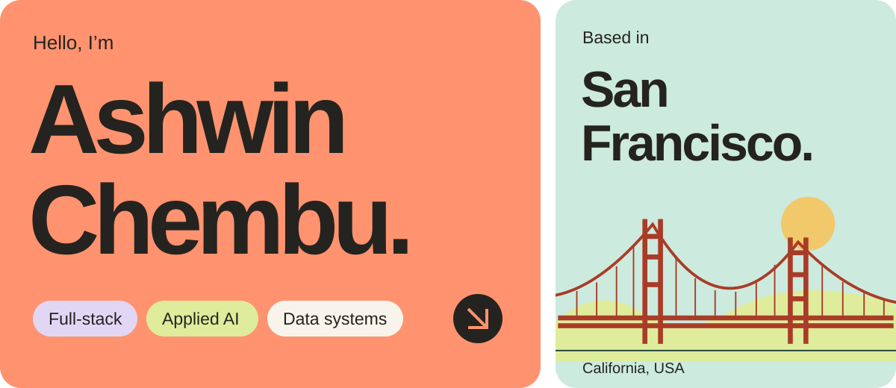

  <a href="https://ashchembu.com"><strong>Portfolio ↗</strong></a> &nbsp; · &nbsp;
  <a href="https://ashchembu.com/resumes/Chembu_Ashwin_General.pdf"><strong>Résumé ↗</strong></a> &nbsp; · &nbsp;
  <a href="https://www.linkedin.com/in/ashwin-chembu-a5292b205/"><strong>LinkedIn ↗</strong></a>

## From messy context to working software.

I’m a **full-stack engineer in San Francisco** building useful products, grounded AI, and reliable services. I connect React and TypeScript interfaces to Python and Node.js APIs, data pipelines, and real-time workflows.

At **ZS Associates**, my work spans applied AI, healthcare data systems, and CRM product workflows. Previously, I co-founded **Tallyrus** and built collaborative research tools with **Tech4Good**. I studied computer science at **UC Davis**.

## Selected work

<table>
  <tr>
    <td width="50%" valign="top">
      <h3><a href="https://github.com/ashwinchembu/work-helper">Lume ↗</a></h3>
      
<strong>Meeting context you can use.</strong> Capture meetings and files, build reusable project knowledge, and retrieve answers with source citations.

      
<code>React</code> <code>Node.js</code> <code>MongoDB</code> <code>RAG</code>

    </td>
    <td width="50%" valign="top">
      <h3><a href="https://github.com/ashwinchembu/render-filedrop">Private Filedrop ↗</a></h3>
      
<strong>Files and work, across devices.</strong> Versioned file exchange and durable job coordination through authenticated APIs, MCP tools, and signed webhooks.

      
<code>Node.js</code> <code>Express</code> <code>S3</code> <code>MCP</code>

    </td>
  </tr>
  <tr>
    <td width="50%" valign="top">
      <h3><a href="https://github.com/ashwinchembu/E-commerceWebsiteDesign">3D Commerce ↗</a></h3>
      
<strong>Configure it. See it.</strong> A responsive storefront and Three.js jacket configurator with garment customization, reusable commerce flows, and WebGL recovery.

      
<code>React</code> <code>TypeScript</code> <code>Three.js</code> <code>Vite</code>

    </td>
    <td width="50%" valign="top">
      <h3><a href="https://github.com/ashwinchembu/forge">Forge ↗</a></h3>
      
<strong>A clearer picture of training.</strong> Bring workouts, nutrition, sleep, and recovery signals together through scheduled integrations, webhooks, and program-aware analysis.

      
<code>Python</code> <code>FastAPI</code> <code>MongoDB</code> <code>Webhooks</code>

    </td>
  </tr>
  <tr>
    <td width="50%" valign="top">
      <h3><a href="https://github.com/ashwinchembu/agent-curtain">Agent Curtain ↗</a></h3>
      
<strong>Privacy with a clear boundary.</strong> A macOS utility that covers connected displays, hands authentication to the real Lock Screen, and restricts its local control interface.

      
<code>Python</code> <code>macOS</code> <code>Unix sockets</code>

    </td>
    <td width="50%" valign="top">
      <h3><a href="https://github.com/ashwinchembu/RAGpoc">Azure RAG Search ↗</a></h3>
      
<strong>Ask questions of your documents.</strong> A proof of concept for multi-format ingestion, chunking, vector retrieval, and citation-backed Q&amp;A.

      
<code>Python</code> <code>Azure OpenAI</code> <code>FAISS</code> <code>LangChain</code>

    </td>
  </tr>
</table>

[More projects and detailed case studies →](https://ashchembu.com/#work)

## Across the stack

| Focus | Tools and practices |
| --- | --- |
| **Product** | React, TypeScript, Next.js, responsive interfaces, Three.js |
| **Services** | Python, Node.js, FastAPI, Express, REST APIs, MCP, WebSockets |
| **Applied AI** | Retrieval, embeddings, source grounding, LangChain, FAISS, LangSmith |
| **Data & cloud** | SQL, Snowflake, MongoDB, Firebase, AWS, Cloudflare Workers / D1 |
| **Quality** | Playwright, Vitest, pytest, authorization tests, human review |

## Research & collaboration

At Tech4Good, I built FigJam collaboration workflows and analyzed **43,340 interaction rows across 2,805 sessions** with Python/Pandas. The [FigJam toolkit](https://github.com/davmantor/FigJam-Widgets) is a shared, collaborator-owned project.

Co-author of:

- **ICER 2024 · Published** — [Evaluating Exploratory Reading Groups for Supporting Undergraduate Research Pipelines in Computing](https://doi.org/10.1145/3632620.3671104).
- **ACM SIGCSE TS 2027 · Accepted / upcoming** — [Improving Curriculum Through Collaboration: Exploring A Participatory Approach to Course Design](https://2027.sigcse-ts.acm.org/track/sigcse-ts-2027-Papers-1).

  
<strong>Find the résumé for your focus</strong>

- [General](https://ashchembu.com/resumes/Chembu_Ashwin_General.pdf)
- [Full-stack / Product](https://ashchembu.com/resumes/Chembu_Ashwin_Full-Stack.pdf)
- [Applied AI / RAG](https://ashchembu.com/resumes/Chembu_Ashwin_Applied-AI.pdf)
- [Backend / Platform](https://ashchembu.com/resumes/Chembu_Ashwin_Backend.pdf)
- [Data / MDM](https://ashchembu.com/resumes/Chembu_Ashwin_Data-MDM.pdf)
- [Frontend](https://ashchembu.com/resumes/Chembu_Ashwin_Frontend.pdf)
- [Solutions / FDE](https://ashchembu.com/resumes/Chembu_Ashwin_Solutions-FDE.pdf)
- [Salesforce / CRM](https://ashchembu.com/resumes/Chembu_Ashwin_Salesforce-CRM.pdf)

---

**Have a hard problem worth solving?** [Let’s talk →](mailto:ashchembu@gmail.com)
